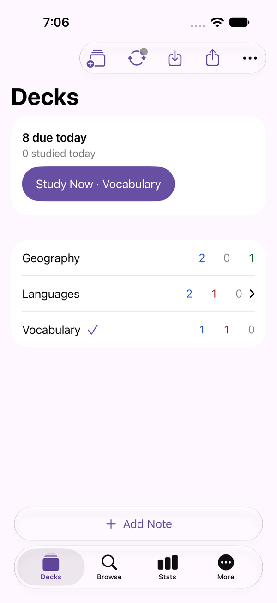
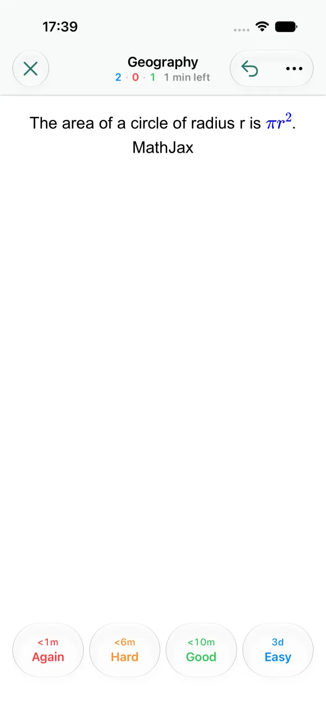
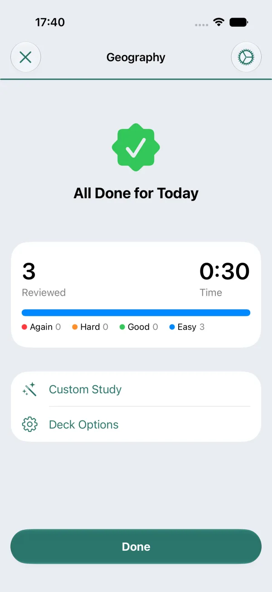
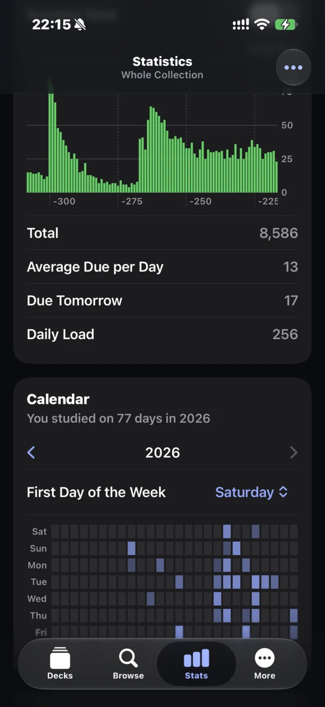

<p align="center">
  
</p>

<h1 align="center">Hayaki for iOS</h1>

<p align="center"><strong>Offline-first flashcards for iPhone and iPad.</strong></p>

<p align="center">
  <a href="https://github.com/amemiya02/Hayaki-iOS/actions/workflows/ci.yml"></a>
  <a href="#get-started"></a>
  <a href="#development"></a>
  <a href="LICENSE"></a>
</p>

<p align="center">
  <a href="README.zh-CN.md">简体中文</a> ·
  <a href="https://github.com/amemiya02/Hayaki">Hayaki for Android</a> ·
  <a href="#get-started">Get started</a> ·
  <a href="https://github.com/amemiya02/Hayaki-iOS/issues">Issues</a>
</p>

Hayaki brings [Hayaki for Android](https://github.com/amemiya02/Hayaki) to iPhone and iPad as a native iOS 26 app built in SwiftUI with Liquid Glass. Your collection lives on your device, so you can study, browse, and edit offline. Hayaki embeds upstream Anki’s Rust core for scheduling, search, sync, and file compatibility with desktop Anki and AnkiDroid.

<p align="center">
  
  
  
  
</p>

## Features

- **Study offline.** Review with Anki scheduling and FSRS, use custom study and filtered decks, and undo a rating. Cards can display images, play audio, and render equations with MathJax.
- **Study comfortably.** The deck name and New · Learning · Due counts sit in the navigation bar, rating buttons are glass with haptic feedback, and each session ends with a summary of cards, time, and ratings. Choose whether cards draw Kanji/Hanzi in Japanese or Chinese forms.
- **Find and edit cards.** Use Anki search syntax, saved searches, configurable columns, and bulk actions in Cards and Notes modes. Edit rich text, media, note types, and card templates. Add a note with `+`, Command-N, the Home Screen quick action, or Siri and Shortcuts.
- **Move your collection.** Import and export `.apkg` and `.colpkg` files. Deck imports merge into the current collection. Collection imports ask for confirmation and create a backup before replacing it.
- **Sync when you choose.** Connect each profile to AnkiWeb or a self-hosted Anki sync server. A glass strip shows progress while syncing, and the Sync screen shows collection and media status separately.
- **See your progress.** A Today card on Decks totals what is due. Statistics shows reviews, time, correct rate, and streak, with charts you can scrub and scroll and a calendar heat map. Set local reminders and keep separate collections in separate profiles.
- **Make it yours.** Pick System, Light, Dark, or Black appearance and any of ten themes, including Paper and Midnight card canvases.
- **Use it on iPhone or iPad.** Navigate with iPhone tabs or the iPad sidebar. On iPad, Browse shows the selected card beside the list, cards keep a readable width, and every shortcut appears when you hold Command. English, Simplified Chinese, and Japanese are supported. The App Groups build also includes Share and deck widgets.

See the [acceptance inventory](docs/specs/ios-acceptance.md) for verified workflows and remaining device checks.

## Get started

Hayaki runs on **iOS and iPadOS 26 or later**. It is currently installed from source with Xcode or by sideloading an IPA with AltStore Classic.

### Build from source

Use an Apple silicon Mac with **Xcode 27** and [rustup](https://rustup.rs/). Install Protocol Buffers and XcodeGen with [Homebrew](https://brew.sh/).

```sh
brew install protobuf xcodegen
git clone https://github.com/amemiya02/Hayaki-iOS.git
cd Hayaki-iOS
scripts/build-core.sh
xcodegen generate
open Hayaki.xcodeproj
```

Run the **Hayaki** scheme on an iPhone or iPad simulator. The first core build fetches the pinned Anki source and builds the device, simulator, and Mac slices. Subsequent app builds can reuse those outputs.

To run on your own device with a Personal Team, generate the app-only project with `xcodegen generate --spec project-personal.yml`. In Xcode, choose your team under **Hayaki → Signing & Capabilities**, select your connected device, and run. A free Apple Account’s provisioning profile lasts seven days. [Apple’s Personal Team documentation](https://developer.apple.com/help/account/basics/about-your-developer-account#enable-a-personal-team-in-xcode)

<details>
<summary>Build an IPA for AltStore Classic</summary>

Run this from the repository root after building the core. The IPA contains the main app and local reminders. Use the App Groups configuration below for Share and widgets.

```sh
(
  set -e
  xcodegen generate --spec project-personal.yml
  xcodebuild -project Hayaki.xcodeproj -scheme Hayaki -configuration Release \
    -destination 'generic/platform=iOS' -derivedDataPath build/AltStoreDerivedData \
    CODE_SIGNING_ALLOWED=NO build

  ipa_dir="$(mktemp -d "$PWD/build/altstore.XXXXXX")"
  mkdir "$ipa_dir/Payload"
  app="$ipa_dir/Payload/Hayaki.app"
  ditto build/AltStoreDerivedData/Build/Products/Release-iphoneos/Hayaki.app "$app"
  codesign --force --sign - --timestamp=none "$app"
  codesign --verify --deep --strict "$app"
  ditto -c -k --norsrc --keepParent "$ipa_dir/Payload" "$ipa_dir/Hayaki.ipa"
  printf '%s\n' "$ipa_dir/Hayaki.ipa"
)
```

Copy `Hayaki.ipa` to Files on your device. In AltStore Classic, open **My Apps → +** and select the IPA. AltStore re-signs it with your Apple Account. With a free account, refresh the app through AltServer before the seven-day signing period expires. [AltStore Classic setup](https://faq.altstore.io/altstore-classic/how-to-install-altstore-macos) · [Refreshing apps with AltServer](https://faq.altstore.io/altstore-classic/altserver)

</details>

<details>
<summary>Install with Share and widgets</summary>

Generate the default project with `xcodegen generate`. In Apple Developer, register the App Group `group.io.github.amemiya02.hayaki` and assign it to the following App IDs.

- `io.github.amemiya02.hayaki`
- `io.github.amemiya02.hayaki.share`
- `io.github.amemiya02.hayaki.widgets`

In Xcode, select the same provisioning team for **Hayaki**, **HayakiShare**, and **HayakiWidgets**, then run **Hayaki** on the device. Both project configurations generate `Hayaki.xcodeproj`. Check your signing team after regenerating. [Apple’s App Groups setup](https://developer.apple.com/documentation/xcode/configuring-app-groups)

</details>

## Development

- [`App/`](App/) contains the SwiftUI entry point. [`Packages/`](Packages/) contains the app shell, collection store, and feature packages. [`core/`](core/) contains the Rust bridge to Anki.
- Run `scripts/test.sh` for package tests against the real core and disposable collections. To include the local sync-server integration tests, run `scripts/build-sync-server.sh` first. For a focused run, use `scripts/test.sh BrowseFeature`.
- [CI](https://github.com/amemiya02/Hayaki-iOS/actions/workflows/ci.yml) builds the app and runs package tests and the iPhone and iPad UI suites on `main`.
- Read the [core build guide](docs/building-the-core.md), [feature package conventions](docs/feature-packages.md), and [iOS parity specification](docs/specs/hayaki-v1.md) before changing those parts of the app.

Bug reports are welcome on [GitHub Issues](https://github.com/amemiya02/Hayaki-iOS/issues). Include your iOS version, the Hayaki version from **More → About**, and the shortest steps to reproduce the problem. Use a sample deck if a collection is needed to demonstrate the issue.

## License and credits

Hayaki is licensed under [AGPL-3.0-or-later](LICENSE). It embeds the [Anki Rust core](https://github.com/ankitects/anki) and its translations, pinned to Anki 26.09.4. The typed-answer and audio replay controls follow Anki’s reviewer. [AnkiDroid](https://github.com/ankidroid/Anki-Android) informed the mobile integration and real-core testing approach. Card equations use [MathJax](https://www.mathjax.org/) 3.2.2 under the Apache License 2.0. The [bundled license](Packages/StudyFeature/Sources/StudyFeature/WebAssets/mathjax/LICENSE) is included with those assets.

Hayaki is independent of Anki, AnkiWeb, and AnkiDroid. Please report Hayaki issues in this repository.
