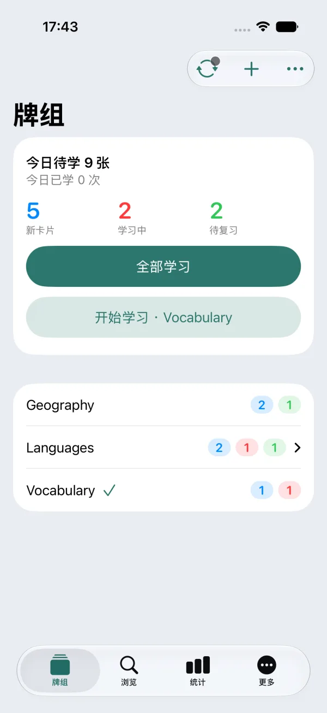
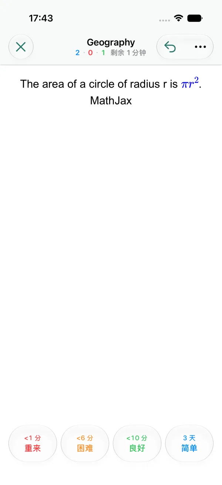
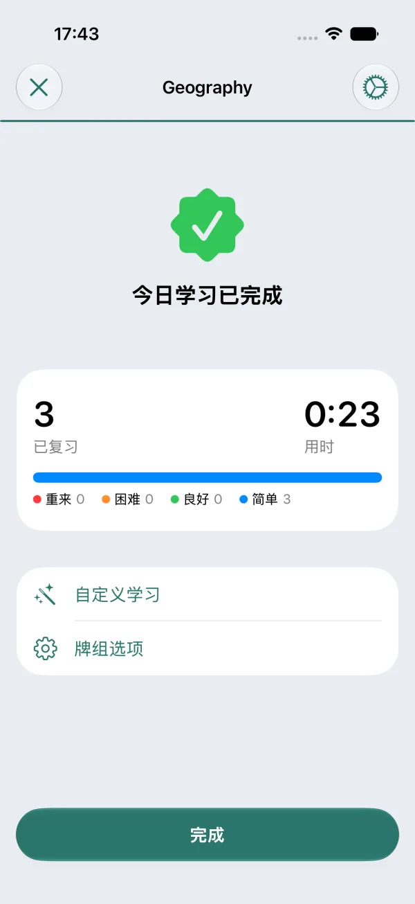
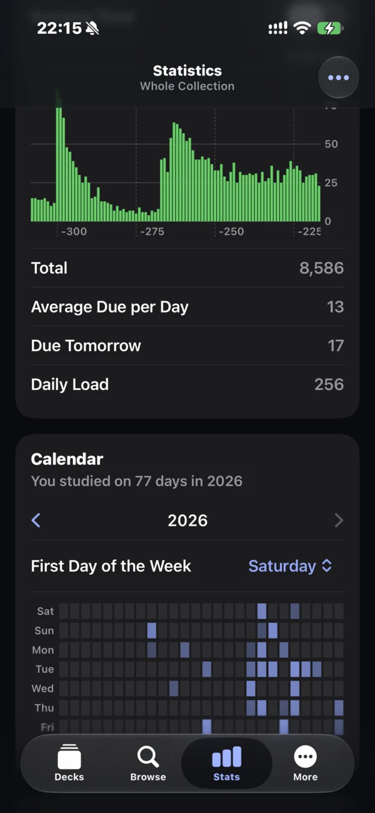

<p align="center">
  
</p>

<h1 align="center">Hayaki for iOS</h1>

<p align="center"><strong>为 iPhone 和 iPad 打造的离线闪卡应用</strong></p>

<p align="center">
  <a href="https://github.com/amemiya02/Hayaki-iOS/actions/workflows/ci.yml"></a>
  <a href="#快速开始"></a>
  <a href="#开发与贡献"></a>
  <a href="LICENSE"></a>
</p>

<p align="center">
  <a href="README.md">English</a> ·
  <a href="https://github.com/amemiya02/Hayaki">Hayaki 安卓版</a> ·
  <a href="#快速开始">快速开始</a> ·
  <a href="https://github.com/amemiya02/Hayaki-iOS/issues">问题反馈</a>
</p>

Hayaki 用 SwiftUI 和 Liquid Glass 打造原生 iOS 26 应用，将 [Hayaki 安卓版](https://github.com/amemiya02/Hayaki) 的学习体验带到 iPhone 和 iPad。集合保存在设备上，离线也能学习、浏览和编辑。应用内嵌上游 Anki 的 Rust 核心，用于复习调度、搜索和同步，并兼容桌面 Anki 和 AnkiDroid 的集合格式。

<p align="center">
  
  
  
  
</p>

## 主要功能

- **离线学习。** 使用 Anki 调度与 FSRS，支持自定义学习、筛选牌组和撤销评分。卡片支持图片、音频和 MathJax 公式。
- **舒适的学习界面。** 牌组名和「新卡 · 学习中 · 待复习」数量显示在导航栏，评分按钮是带触感反馈的玻璃按钮，每次学习结束会显示卡片数、用时和评分分布。卡片中的汉字可以选择日文或中文字形。
- **搜索和编辑。** 支持 Anki 搜索语法、保存搜索、配置列和批量操作，可在卡片和笔记之间切换。支持编辑富文本、媒体、笔记类型和卡片模板。可以通过 `+` 按钮、Command-N、主屏幕快捷操作或 Siri 与快捷指令添加笔记。
- **迁移集合。** 支持导入和导出 `.apkg` 与 `.colpkg`。牌组包合并到当前集合。导入集合包时，应用会在用户确认后先备份，再替换当前集合。
- **按需同步。** 每个档案可选择 AnkiWeb 或自托管 Anki 同步服务器。同步时底部玻璃条显示进度，同步页分别显示集合和媒体的状态。
- **查看学习进度。** 牌组页的今日卡片汇总待学数量。统计页显示复习数、用时、正确率和连续天数，图表可拖动查看数值、横向滚动，还有日历热力图。可设置本地提醒，也可以用独立档案管理不同的集合。
- **个性化外观。** 外观可选跟随系统、浅色、深色或纯黑，并提供十个主题，其中「纸」和「夜空」主题会改变卡片底色。
- **适配 iPhone 和 iPad。** iPhone 使用标签栏，iPad 使用侧栏。iPad 上浏览页在列表旁显示所选卡片，卡片保持适合阅读的宽度，按住 Command 可查看全部快捷键。支持英语、简体中文和日语。启用 App Groups 的版本还提供分享扩展和牌组小组件。

已验证的流程和待完成的设备测试记录在 [iOS 验收清单](docs/specs/ios-acceptance.md) 中。

## 快速开始

Hayaki 支持 **iOS 和 iPadOS 26 及以上版本**。目前可以从源码用 Xcode 安装，或通过 AltStore Classic 侧载 IPA。

### 从源码构建

需要一台 Apple 芯片 Mac、**Xcode 27** 和 [rustup](https://rustup.rs/)。使用 [Homebrew](https://brew.sh/) 安装 Protocol Buffers 和 XcodeGen。

```sh
brew install protobuf xcodegen
git clone https://github.com/amemiya02/Hayaki-iOS.git
cd Hayaki-iOS
scripts/build-core.sh
xcodegen generate
open Hayaki.xcodeproj
```

在 Xcode 中选择 **Hayaki** scheme，在 iPhone 或 iPad 模拟器上运行。首次构建核心会下载固定版本的 Anki 源码，生成真机、模拟器和 Mac 所需的产物。后续构建 App 可以复用这些产物。

如果想用 Personal Team 安装到自己的设备，先运行 `xcodegen generate --spec project-personal.yml` 生成纯主应用项目。在 Xcode 的 **Hayaki → Signing & Capabilities** 中选择自己的开发团队，再选中已连接的设备运行。免费 Apple 账号的描述文件有效期为七天。 [Apple Personal Team 文档](https://developer.apple.com/help/account/basics/about-your-developer-account#enable-a-personal-team-in-xcode)

<details>
<summary>打包适用于 AltStore Classic 的 IPA</summary>

构建核心后，在仓库根目录运行以下命令。这个 IPA 包含主应用和本地提醒。需要分享扩展和小组件时，请使用下一节的 App Groups 配置。

```sh
(
  set -e
  xcodegen generate --spec project-personal.yml
  xcodebuild -project Hayaki.xcodeproj -scheme Hayaki -configuration Release \
    -destination 'generic/platform=iOS' -derivedDataPath build/AltStoreDerivedData \
    CODE_SIGNING_ALLOWED=NO build

  ipa_dir="$(mktemp -d "$PWD/build/altstore.XXXXXX")"
  mkdir "$ipa_dir/Payload"
  app="$ipa_dir/Payload/Hayaki.app"
  ditto build/AltStoreDerivedData/Build/Products/Release-iphoneos/Hayaki.app "$app"
  codesign --force --sign - --timestamp=none "$app"
  codesign --verify --deep --strict "$app"
  ditto -c -k --norsrc --keepParent "$ipa_dir/Payload" "$ipa_dir/Hayaki.ipa"
  printf '%s\n' "$ipa_dir/Hayaki.ipa"
)
```

把 `Hayaki.ipa` 复制到 iPhone 或 iPad 的「文件」App。在 AltStore Classic 进入 **My Apps → +** 并选中 IPA，AltStore 会用你的 Apple 账号重新签名。使用免费账号时，请通过 AltServer 在七天有效期内刷新签名。 [AltStore Classic 安装](https://faq.altstore.io/altstore-classic/how-to-install-altstore-macos) · [使用 AltServer 刷新](https://faq.altstore.io/altstore-classic/altserver)

</details>

<details>
<summary>安装带分享扩展和小组件的版本</summary>

使用 `xcodegen generate` 生成默认项目。在 Apple Developer 注册 App Group `group.io.github.amemiya02.hayaki`，并分配给以下 App ID。

- `io.github.amemiya02.hayaki`
- `io.github.amemiya02.hayaki.share`
- `io.github.amemiya02.hayaki.widgets`

在 Xcode 中为 **Hayaki**、**HayakiShare** 和 **HayakiWidgets** 选择同一个签名团队，然后在设备上运行 **Hayaki**。两种配置都会生成 `Hayaki.xcodeproj`，重新生成后请检查签名团队。 [Apple App Groups 配置文档](https://developer.apple.com/documentation/xcode/configuring-app-groups)

</details>

## 开发与贡献

- [`App/`](App/) 是 SwiftUI 应用入口，[`Packages/`](Packages/) 包含应用框架、集合存储和各项功能，[`core/`](core/) 是连接 Anki 的 Rust 桥接层。
- 运行 `scripts/test.sh`，用真实核心和临时集合执行包测试。要同时运行本地同步服务器集成测试，先执行 `scripts/build-sync-server.sh`。只测试浏览功能可以运行 `scripts/test.sh BrowseFeature`。
- [CI](https://github.com/amemiya02/Hayaki-iOS/actions/workflows/ci.yml) 会构建 App，并在 `main` 上运行包测试以及 iPhone 和 iPad 界面测试。
- 修改相关模块前，可以查阅 [核心构建指南](docs/building-the-core.md)、[功能包开发约定](docs/feature-packages.md) 和 [iOS 功能规格](docs/specs/hayaki-v1.md)。

欢迎在 [GitHub Issues](https://github.com/amemiya02/Hayaki-iOS/issues) 反馈问题。请附上 iOS 版本、Hayaki「更多 → 关于」里的版本，以及最短复现步骤。如果问题需要集合才能复现，请使用示例牌组。

## 许可与致谢

Hayaki 采用 [AGPL-3.0-or-later](LICENSE) 许可证，内嵌固定在 Anki 26.09.4 的 [Anki Rust 核心](https://github.com/ankitects/anki)及其翻译。输入答案和音频重播控件沿用了 Anki 复习器的设计。移动端集成与真实核心测试参考了 [AnkiDroid](https://github.com/ankidroid/Anki-Android)。卡片公式由 [MathJax](https://www.mathjax.org/) 3.2.2 渲染，采用 Apache License 2.0。[许可证文本](Packages/StudyFeature/Sources/StudyFeature/WebAssets/mathjax/LICENSE)随资源一同提供。

Hayaki 是独立项目。与 Hayaki 有关的问题请在本仓库反馈。
